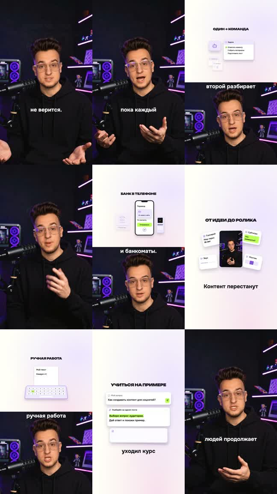

# Монтаж ТОП — исходник → готовый Reels

Скопируйте в чат **Codex или Claude Code на компьютере**:

```text
Скачай и установи этот скилл: https://github.com/evermarkdream-spec/reels-montage-pro
```

Агент скачает комплект, подготовит проект и попросит исходное видео. Пришлите ролик или укажите путь к нему — получите MP4 со смысловой нарезкой, короткими субтитрами, объёмным хуком, предметной графикой и музыкой в стиле Марка. Технические команды вводить самостоятельно не нужно.

**Актуализация: 15 ноября 2026.** Основной стиль — «Мир нейросетей через 10 лет», возвращённый автором 13 ноября: Onest/Unbounded, светлая бело-фиолетовая палитра, лаймовые акценты, объёмные предметы и последовательные действия. Сцены создаются по вашей речи.

Нужен локальный агент с доступом к файлам и запуску команд. Первая установка загружает зависимости и занимает время; обычный чат без выполнения программ не сможет отрендерить видео. Если агент запросит системное разрешение на установку, подтвердите его. После первого ролика продолжайте в созданной папке — стиль и правки сохраняются там.

[Видеоэталон](assets/reference/last-reel.mp4?raw=true) · [Что делает агент при установке](references/INSTALLATION.md) · [Инструкция скилла](SKILL.md)



Внутри: рабочий Remotion-проект, локальные шрифты, музыка, монтажные скрипты, правила и примеры сцен. Рендер локальный, распознавание через Whisper; платные подписки и аккаунты не входят. Маска хука строится заново по вашему видео; если маттинг недоступен, агент использует читаемый объёмный заголовок без перекрытия лица.

[Источники и лицензии](CREDITS.md) · [Проверки и ограничения](references/VALIDATION.md)
