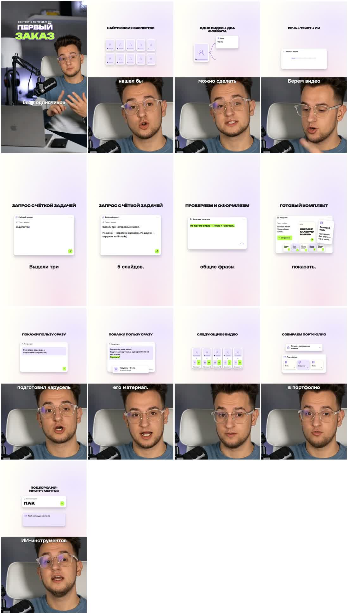

# Монтаж ТОП — скилл для ваших Reels

Передайте своё видео Codex или Claude Code — агент соберёт вертикальный ролик по правилам «Монтаж ТОП»: смысловая нарезка, короткие субтитры, объёмный заголовок, светлая предметная графика, анимации и музыка тише голоса.

**Это полный комплект для монтажа на компьютере.** Внутри уже есть рабочий проект Remotion, шрифты, оформление субтитров, компоненты анимации и видеоэталон. Аккаунт GitHub для скачивания публичного репозитория не нужен. Для работы нужен установленный Codex или Claude Code с доступом к файлам и командам на компьютере; подписка и инструменты AI-агента в комплект не входят.

## Один промпт для старта

Скачайте [готовый ZIP-комплект](https://github.com/evermarkdream-spec/reels-montage-pro/releases/latest), распакуйте его, откройте полученную папку в Codex или Claude Code и отправьте только это:

```text
Установи вот этот скилл и начинай: https://github.com/evermarkdream-spec/reels-montage-pro
```

Дальше агент сам прочитает комплект, установит скилл, подготовит проект и попросит ваш исходный ролик. После установки просто отвечайте на его вопросы и прикладывайте материалы, которые он запросит. Технические команды ученику знать не нужно.

## Посмотрите исходный стиль

[Скачать и посмотреть видеоэталон](assets/reference/last-reel.mp4?raw=true) · [Полная инструкция ученику](STUDENT_GUIDE.md) · [Техническая установка](references/INSTALLATION.md)



Эталон задаёт оформление и приёмы, а длительность, сцены и монтаж нового видео строятся по вашей речи. Это не обещание покадровой копии. Первый ролик нужно просмотреть целиком со звуком и при необходимости дать правки.

## Что включено

| Материал | Где находится |
| --- | --- |
| Инструкция AI-агенту | [SKILL.md](SKILL.md) |
| Стиль, порядок монтажа и настройка по референсам | [references](references/) |
| Рабочий проект и правила монтажа | [assets/montage-project](assets/montage-project/) |
| Субтитры, хук, оформление и шрифты | `src/student-style.tsx`, `scripts/import-video.py`, `public/fonts` внутри проекта |
| Анимации и предметные сцены | `src/scenes` и [примеры из финального ролика](assets/reference/) |
| Музыка и короткие звуки | `public/music`, `public/soft-move.wav`, `public/soft-tick.wav` внутри проекта |
| Установка скилла и создание проекта | [scripts](scripts/) |
| История проверок и ограничения | [VALIDATION.md](references/VALIDATION.md) |
| Происхождение и лицензии | [CREDITS.md](CREDITS.md) |

Субтитры и их тайминги создаются заново из вашего видео. Для первого запуска нужны Node.js/npm, Python 3.11+, FFmpeg/FFprobe, интернет и место для зависимостей и модели Whisper. Агент проверяет окружение; распознавание предусмотрено локально. Рендер и установка требуют времени. Мобильный браузер сам по себе этот комплект не запускает.

## Если скачиваете вручную

Нажмите **Code → Download ZIP**, распакуйте **всю** папку и откройте её в агенте. Попросите прочитать `SKILL.md` и смонтировать ваш исходник. Не скачивайте только один файл SKILL.md — без остальных файлов монтаж не заработает. `START_HERE.html` можно открыть локально в браузере после распаковки.

## Как менять стиль под себя

Прикладывайте доступные видео-референсы и называйте понравившиеся моменты. Например: «Из первого ролика возьми оформление субтитров, из второго — движение карточек. Сделай тест на 10–15 секунд моего видео». Процесс и готовые промпты — в [инструкции ученику](STUDENT_GUIDE.md).

Агент сохраняет принятые решения в `STYLE_PROFILE.md`, настройках и коде вашего проекта. Это сохранение правил и примеров, а не переобучение модели. Чужие материалы не используются как ваши личные результаты. Готовые видео и исходники ученика не нужно загружать в этот публичный репозиторий.
